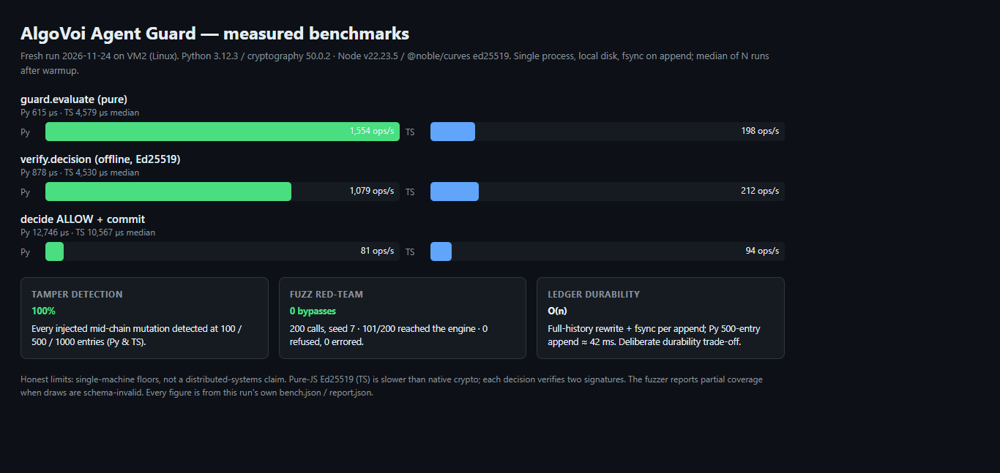

# Measured evidence - 2026-11-24 run (TypeScript port)

Figures come from this run's own [`bench.json`](bench.json). The cross-language
conformance and interop suites are part of `npm test` (39 tests), not this perf run.

## Environment

- Host: VM2 cleanroom (`ubuntu`, Linux), inside the `node:22-slim` image (the pinned gate runtime).
- Node v22.23.5; Ed25519 via `@noble/curves` (pure JS, no native build).
- Single process, local disk, `fsync` on append; median of N runs after warmup.
- Date: 2026-11-24.

## Performance (`tools/bench.mjs`, real `performance.now()`)

| Hot path | ops/s | median |
|---|---|---|
| `evaluate()` (pure) | 198.0 | 4.58 ms |
| `verifyDecision()` (offline) | 211.9 | 4.53 ms |
| `decide()` ALLOW + commit | 93.5 | 10.57 ms |

Pure-JS Ed25519 is slower than a native backend (each decision verifies two signatures);
auditability and offline recomputability are favoured over throughput. Append and verify
are O(n); every injected mid-chain mutation was detected at 100 / 500 / 1000 entries.



## Cross-language conformance

The port is byte-conformant with the Python reference and the frozen public L1 vectors:
`test/conformance.test.mjs` (11), `test/interop.test.mjs` (8), and the reverse-direction
`tools/verify_ts_fixtures.py` (8 Python checks). These run under `npm test` / the Python
gate; this file records the perf run only.

## Reproduce

```bash
npm ci
node tools/bench.mjs                 # -> bench.json
node tools/gen_benchmarks.mjs        # -> BENCHMARKS.md
npm test                             # build + node --test (39 tests)
```

## Honest limits

- Single-machine floors; not a distributed-systems claim.
- Ed25519 only; the post-quantum engine is a separate product.
- The guard moves no funds; no production adoption is claimed.
- This port covers the core library; the autonomous red-team engine and demo CLI live in
  the Python reference.
